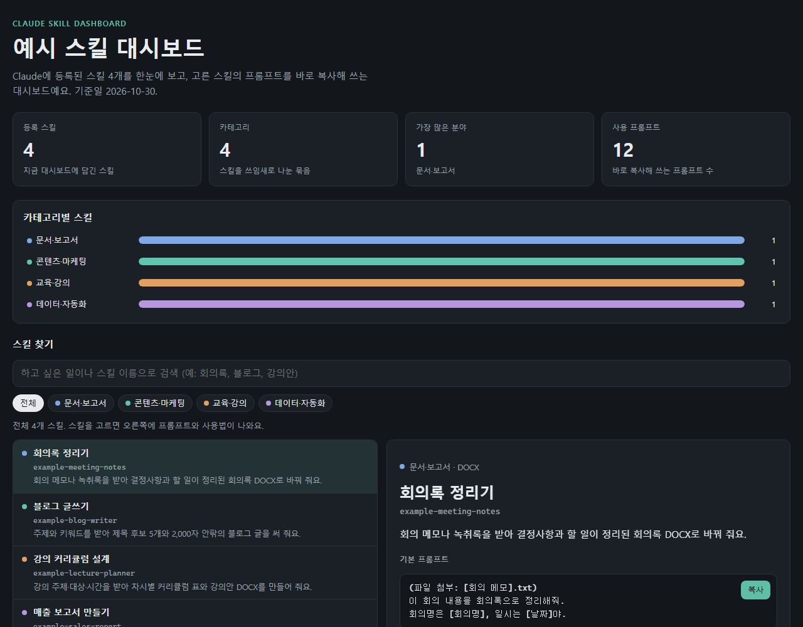

# 스킬 대시보드 만들기 (skill-dashboard-maker)

[](https://creativecommons.org/licenses/by-nc-sa/4.0/deed.ko)


내 Claude에 등록된 스킬을 모두 읽어서 **스킬 대시보드 HTML 한 장**으로 정리해 주는 Claude 스킬이에요.

> "스킬 대시보드 만들어줘" 한 마디면 → 스킬마다 한국어 이름·한 줄 요약·입력과 결과물·**바로 복사해 쓰는 프롬프트**가 정리된 대시보드가 나와요.



<sub>가상 스킬 4개로 만든 예시예요. 실제 파일: [`examples/sample-skill-dashboard.html`](examples/sample-skill-dashboard.html)</sub>

## 무엇을 하나요

| 단계 | 하는 일 | 남는 것 |
|---|---|---|
| 1. 수집 | 등록된 스킬 폴더를 훑어 이름·설명·부속 파일을 모아요 | 스킬 목록 |
| 2. 갱신 확인 | 이전 대시보드를 첨부했으면 추가·수정·삭제된 스킬만 골라내요 | 다시 정리할 목록 |
| 3. 스킬별 정리 | SKILL.md를 끝까지 읽고 한국어 이름, 요약, 입력·결과물, 기본·상황별 프롬프트, 팁을 정리해요 | 스킬별 항목 |
| 4. 대시보드 | 디자인 템플릿에 넣어 단일 HTML 파일로 만들어요 | `skill-dashboard.html` |

대시보드에서 할 수 있는 것:

- 검색, **8개 카테고리** 필터 (문서·보고서 / 콘텐츠·마케팅 / 교육·강의 / 책·출판 / 기획·분석 / 영상·디자인 / 데이터·자동화 / 기타)
- 스킬마다 **기본 프롬프트 + 상황별 프롬프트** 복사 버튼
- 라이트·다크 모드, 휴대폰 화면
- 인터넷 없이 열리는 파일 하나
- 이전 대시보드를 첨부하면 **바뀐 스킬만 다시 정리**하고 맨 위에 추가·수정·삭제 내역 표시

## 설치

### A. Claude.ai (웹·데스크톱 앱)

1. [`dist/skill-dashboard-maker.skill`](dist/skill-dashboard-maker.skill) 을 내려받아요 (파일을 열고 **Download raw file**).
2. claude.ai → 왼쪽 아래 내 이름 → **설정 → 기능** → '코드 실행 및 파일 생성'의 **클라우드에서 코드 실행**을 켜요.
3. 왼쪽 메뉴 **사용자 지정 → Skills → + 추가 → Skill 업로드** → 받은 `.skill` 파일을 넣고 **업로드**. (압축은 풀지 않아요)
4. 목록에 skill-dashboard-maker가 보이고 스위치가 켜져 있으면 끝이에요.

### B. Claude Code (플러그인 마켓플레이스)

Claude Code 안에서:

```text
/plugin marketplace add NogadaHunter/skill-dashboard-maker
/plugin install skill-dashboard-maker@peopleware-skill-dashboard
```

터미널에서:

```bash
claude plugin marketplace add NogadaHunter/skill-dashboard-maker
claude plugin install skill-dashboard-maker@peopleware-skill-dashboard
```

### C. 직접 복사

[`plugins/skill-dashboard-maker/skills/skill-dashboard-maker/`](plugins/skill-dashboard-maker/skills/skill-dashboard-maker/) 폴더를 통째로 `~/.claude/skills/` 아래에 복사해요.

## 사용 예

| 상황 | 이렇게 말하세요 |
|---|---|
| 처음 만들기 | `스킬 대시보드 만들어줘` |
| 이름 지정 | `[이름] 이름으로 스킬 대시보드 만들어줘` |
| 제목 직접 지정 | `'[마케팅팀 스킬 모음]'으로 스킬 대시보드 만들어줘` |
| 갱신 | (이전 `skill-dashboard.html` 첨부) `스킬 대시보드 갱신해줘` |

만들어진 대시보드에서 스킬을 고르면 나오는 프롬프트를 **복사**해 대화창에 붙여 넣으면 돼요. 상황별 프롬프트 전체: [`docs/USAGE.md`](docs/USAGE.md)

> 영어판: [skill-dashboard-maker-en](https://github.com/NogadaHunter/skill-dashboard-maker-en) — 화면과 설명이 모두 영어인 전 세계용 버전이에요.

> [!NOTE]
> 대시보드는 자동으로 바뀌지 않아요. 스킬을 추가·수정·삭제했으면 이전 대시보드를 첨부하고 "스킬 대시보드 갱신해줘"라고 요청하세요.

## 어디에 있는 스킬을 읽나요

| 환경 | 찾는 위치 |
|---|---|
| Claude.ai | `/mnt/skills/user` (내가 올린 스킬) |
| Claude Code | `~/.claude/skills` (개인 스킬) |

다른 위치에 있는 스킬을 정리하려면 "스킬 폴더는 [경로]야"라고 알려 주세요. 이 스킬 자신은 목록에서 빠져요.

## 개인정보

- 대시보드 제목에는 **사용자가 알려 준 이름만** 들어가요. 스킬 파일에는 어떤 개인·회사 이름도 들어 있지 않아요.
- 스킬 폴더 경로 대신 'claude.ai 등록 스킬', 'Claude Code 개인 스킬' 같은 일반 문구만 남겨서, PC 계정 이름이 대시보드에 찍히지 않아요.

## 필요한 것

- Claude.ai: **클라우드에서 코드 실행** 켜기
- Claude Code: Python 3 (표준 라이브러리만 써서 따로 설치할 것이 없어요)

## 폴더 구조

```text
skill-dashboard-maker/
├── .claude-plugin/marketplace.json        ← Claude Code 마켓플레이스 목록
├── plugins/skill-dashboard-maker/
│   ├── .claude-plugin/plugin.json         ← 플러그인 정보 (이름·버전)
│   └── skills/skill-dashboard-maker/      ← 스킬 본체
│       ├── SKILL.md                       ← 단계와 규칙
│       ├── scripts/                       ← collect_skills.py · build_dashboard.py
│       ├── assets/dashboard-template.html ← 대시보드 디자인
│       └── references/writing-guide.md    ← 스킬별 항목 작성 기준·카테고리
├── dist/skill-dashboard-maker.skill       ← Claude.ai 업로드용
├── docs/                                  ← 사용 프롬프트, 화면, 올리는 법
├── examples/                              ← 가상 스킬 4개와 예시 대시보드
└── tools/                                 ← build_skill.py · check_repo.py
```

## 고칠 때

스킬을 고친 뒤에는 `python tools/build_skill.py` 로 `dist/` 를 다시 만들고 `plugin.json` 의 `version` 을 올려 주세요. 변경 내역: [`CHANGELOG.md`](CHANGELOG.md)

## 라이선스

[CC BY-NC-SA 4.0](LICENSE) — 출처를 밝히면 자유롭게 쓰고 고칠 수 있어요. 단, **영리 목적으로 쓸 수 없고**, 고친 것도 같은 조건으로 공유해야 해요.
이 도구로 만든 대시보드의 내용은 그것을 만든 사용자의 것이에요.

## 만든 곳

피플웨어교육컨설팅그룹 · AI프롬프트연구소

---

### English summary

A Claude skill (and Claude Code plugin) that reads every skill registered in your Claude and turns them into a single, offline HTML **skill dashboard**: Korean names, one-line summaries, inputs and outputs, and copy-ready default and situational prompts for each skill, with search, 8 category filters, light/dark mode and mobile layout. Attach a previous dashboard to refresh only the skills that were added, changed or removed. Licensed under CC BY-NC-SA 4.0.

**English edition:** [skill-dashboard-maker-en](https://github.com/NogadaHunter/skill-dashboard-maker-en) (English interface and instructions, MIT license)
